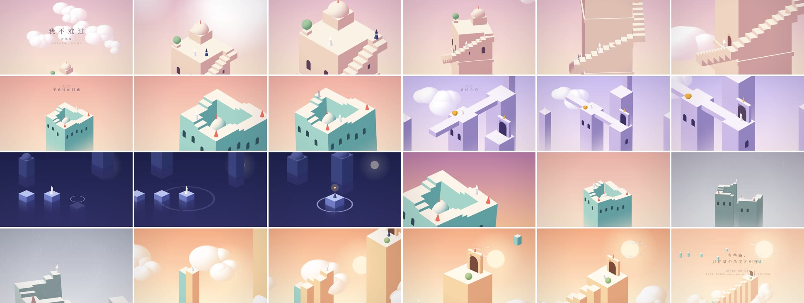

# 101 纪念碑谷风格音乐 MV《我不难过》（纯代码生成）

> 用代码"拍"一支《纪念碑谷》画风的音乐 MV：等距视角、不可能几何、粉彩平涂、戴尖帽的白衣小人。
> 导入歌曲 MP3 和 LRC 歌词后，分镜会**自动对齐段落**，每一句歌词都会触发画面动作。



---

## 一、导演阐述：为什么是纪念碑谷 × 《我不难过》

《纪念碑谷》最迷人的地方是**不可能的几何**：彭罗斯阶梯只有从某一个角度看才"首尾相连"，换个角度就会露馅。

《我不难过》唱的也是这样一句话：嘴上说"我不难过"，可这句话只有在某个角度才成立。

所以整支 MV 只有一个核心隐喻：

> **"我不难过"是一个视觉错觉。**
> 副歌里，她在一条完美闭合的回廊上一直往上走，却永远回到原点（假装没事）；
> 桥段里，镜头绕离那个"唯一正确的角度"，回廊断开了：原来路从来没有相连（承认难过）；
> 最后的副歌，云海里一根一根升起真正相连的台阶，她独自登顶（放下，自由）。

片尾字幕：**「有些路，只在某个角度才相连。」**

---

## 二、画风提取（Style Bible）

| 要素 | 纪念碑谷的做法 | 本片的实现 |
|---|---|---|
| 视角 | 等距正交投影，没有透视 | 正交相机，俯角 35.264°、方位 45°（真等距角，彭罗斯错觉只在此角度成立） |
| 光影 | 不用真实光照，每个面一种颜色 | 着色器按法线取色：顶面最亮 / 左面中间 / 右面最暗 |
| 空间感 | 柱子向下沉入天色里 | "高度雾"：越往下越融进天空底色 |
| 建筑语汇 | 伊斯兰 / 印度阶梯井 / 摩洛哥宫殿 | 方塔、穹顶、尖塔、拱门拱窗、螺旋阶梯、圆形树冠 |
| 机关 | 旋转手柄、升降石柱、地面按钮 | 金色转轮让石桥旋转 90°，石柱随歌词升起 |
| 角色 | 白色尖帽、白袍、无表情、安静地走 | 白帽小人（她）与深蓝帽小人（"你"） |
| 动效 | 缓入缓出，机关带一点回弹 | `inOut` 缓动 + `outBack` 回弹，镜头不做急切运动 |
| 章节 | 每关一个标题卡 | 每章开头浮现"第 X 章 · 章名"，细衬线、宽字距 |
| 字体 | 细、优雅、大字距 | 思源宋体（Noto Serif SC）300/500，歌词字距由宽收紧 |

### 每章配色

| 章节 | 天空 | 石材（顶 / 左 / 右） | 情绪 |
|---|---|---|---|
| 序章 / 第一章 回声之塔 | 玫瑰粉 → 奶桃 | `#FBF2E6` `#EFD3C3` `#CF9FA0` | 清晨、告别 |
| 第二章 不难过的回廊 | 珊瑚 → 奶油 | `#FDF5E9` `#A4D4CA` `#5F9FA2` | 明亮地强撑 |
| 第三章 旋转之庭 | 淡紫 → 雾粉 | `#F8F3FB` `#CDBBE7` `#9383BF` | 试着换条路 |
| 第四章 夜之水阶 | 深海蓝 → 紫夜 | `#BCC6F2` `#717CC6` `#454E96` | 孤独、够不到 |
| 副歌二（黄昏回廊） | 暮紫 → 杏橙 | 同回廊 | 越走越快的徒劳 |
| 第五章 换一个角度 | 褪色灰 + 雨 | 回廊配色逐渐去饱和 | 承认 |
| 第六章 自由之阶 / 尾声 | 日出橙 → 奶金 | `#FFF9EE` `#F7D7A8` `#E3A57D` | 释然、自由 |

---

## 三、分镜表

段落时间由歌词**自动对齐**（见第四节），下表的"段内进度"是镜头在该段落里的位置，0% 为段落开始。

### 前奏 · 序章
| 段内 | 镜头 | 画面 | 运镜 |
|---|---|---|---|
| 0% | 云海 | 粉色晨雾中云层缓缓飘过，片名「我不难过」浮现 | 高空俯视，缓慢偏转 |
| 38% | 穿云而下 | 穿过云层，露出云上的白色高塔与圆顶，两个小人并肩站着 | 升降镜头下降 + 推近 |
| 72% | 转身 | 深蓝帽的"你"转身走下台阶，白帽小人留在原地 | 等距固定机位，缓推近 |

### 主歌一 · 第一章 回声之塔
| 段内 | 镜头 | 画面 | 运镜 |
|---|---|---|---|
| 0% | 独自下塔 | 她沿螺旋阶梯往下走，追着那个人走过的路 | **环绕跟拍**：镜头随她绕塔旋转 |
| 30% | 脚印发光 | 每唱一句，她脚下的台阶亮起一枚光点 | 跟拍 + 每句轻推（"呼吸"） |
| 55% | 回声 | "你"的幽灵身影在前方台阶浮现又消散 | 中景，慢摇 |
| 84% | 门 | 塔底拱门亮起，她转身走进光里 | 推近 → 白光转场 |

### 副歌一 · 第二章 不难过的回廊
| 段内 | 镜头 | 画面 | 运镜 |
|---|---|---|---|
| 0% | 不可能的回廊 | 彭罗斯阶梯：她一直往上走，却永远回到原点 | **锁死等距视角**（错觉成立的唯一角度） |
| 22% | 绕圈 | 镜头贴着她绕圈；含"难过"的句子让回廊闪一下光 | 跟拍 + 节拍缩放 |
| 50% | 强撑 | 画面微微倾斜，像一个强撑的笑 | 荷兰角 ±4° |
| 80% | 原地打转 | 拉远，回廊完整显现 | 快速拉远 |

### 间奏 · 第三章 旋转之庭
| 段内 | 镜头 | 画面 | 运镜 |
|---|---|---|---|
| 0% | 断桥 | 淡紫色庭院，十字石桥没有对上路 | 等距全景 |
| 20% | 转动机关 | 她转动金色手柄，整座桥旋转 90° 接上新路 | 推近，回弹缓动 |
| 58% | 过桥 | 走过新接上的桥，来到拱门前 | 横移跟拍 |
| 86% | 入夜 | 拱门亮起，她走进夜色 | 暗场转场 |

### 主歌二 · 第四章 夜之水阶
| 段内 | 镜头 | 画面 | 运镜 |
|---|---|---|---|
| 0% | 夜海 | 星空倒映在水面，一根石柱托着她 | 低俯角（26°） |
| 12% | 一句一阶 | **每唱一句，前方升起一根石柱**（带涟漪），她跳过去 | 侧向跟拍 |
| 68% | 远方的人 | 远处高柱上，"你"提着灯，始终够不到 | 横摇至远处 |
| 86% | 沉没 | 那根柱子沉进水里，灯飘向夜空 | 定镜，涟漪扩散 |

### 副歌二 · 黄昏回廊
| 段内 | 镜头 | 画面 | 运镜 |
|---|---|---|---|
| 0% | 黄昏回廊 | 回到回廊，天色变成黄昏，她走得更快 | 等距锁定，节拍缩放更大 |
| 45% | 越走越快 | 倾斜加剧，原地打转的徒劳感 | 荷兰角 ±6° + 推拉 |
| 85% | 停步 | 她慢下来，停住，抬头 | 缓慢拉远 |

### 桥段 · 第五章 换一个角度（全片高潮）
| 段内 | 镜头 | 画面 | 运镜 |
|---|---|---|---|
| 0% | 错觉 | 仍是完美闭合的回廊，她走到最高一级 | 等距视角 |
| 15% | 破绽 | **镜头绕离等距角，回廊裂成两座塔**：原来从来没有相连 | 环绕运镜 45°→100°，俯角降到 16° |
| 50% | 承认 | 她坐在断口边缘，帽子低垂；颜色褪去，开始下雨 | 缓推至近景，荷兰角 −4° |
| 85% | 寂静 | 碎块悬浮，画面渐亮 | 定镜 → 暖白转场 |

### 终副歌 · 第六章 自由之阶
| 段内 | 镜头 | 画面 | 运镜 |
|---|---|---|---|
| 0% | 日出 | 金色晨光，云海上只剩一块回廊碎片 | 等距全景 |
| 8% | 一句一阶 | **每唱一句，一根石柱从云海升起**，组成真正相连的台阶 | 跟拍上升 |
| 60% | 放手 | 山顶的"你"向她点头，化作一群白鸟飞走（唱到"自由/飞"的那句触发） | 中景 → 鸟群 |
| 84% | 登顶 | 她独自登顶，站在拱门前 | 缓推 |

### 尾奏
| 段内 | 镜头 | 画面 | 运镜 |
|---|---|---|---|
| 0% | 远眺 | 镜头拉远升高，云上的纪念碑全貌，白鸟绕着太阳飞 | 大幅拉远 + 升高 |
| 40% | 片尾 | 「有些路，只在某个角度才相连。」+ 演职员表（取自 LRC） | 定格 |

### 运镜衔接（全片一镜流转）

| 衔接 | 方式 | 画面 |
|---|---|---|
| 前奏 → 主歌一 | 同场景镜头接力（3 秒） | 塔顶全景平滑接到绕塔跟拍 |
| 主歌一 → 副歌一 | 推进穿越 + 白光 | 推进发光的拱门，回廊之塔在门的位置浮现 |
| 副歌一 → 间奏 | 推进穿越 + 白光 | 回廊全景推近，溶进紫色庭院 |
| 间奏 → 主歌二 | 推进穿越 + 深蓝 | 推进拱门，入夜 |
| 主歌二 → 副歌二 | 推进穿越 + 暖光 | 沉没的石柱与涟漪，溶进黄昏回廊 |
| 副歌二 → 桥段 | **一镜到底** | 她停下、继续走向断口，镜头直接绕离等距角，回廊断开 |
| 桥段 → 终副歌 | 推进穿越 + 暖白 | 雨中近景，溶进日出 |
| 终副歌 → 尾奏 | 一镜到底 | 登顶后直接拉远升高 |

实现上保证"丝滑"的几件事：

- **关键帧不顿挫**：镜头关键帧之间用单调三次样条插值，穿过中间关键帧时不减速、不过冲，只在段首段尾缓入缓出。
- **跟拍不颠簸**：镜头跟的是角色前后约 1 秒位置的加权平均，不随每一步、每一跳上下抖；角色转身取前后两点的连线方向，拐角处自然转身。
- **推进穿越**：换场景时两个画面交叉溶解，旧画面加速推近、淡出，新画面从稍远处继续推近、淡入，两边的推进速度在中点相接，运动感不断。
- **逐帧检测**：以 30fps 逐帧追踪全片的机位与角色屏幕位置，确认没有跳变、没有急停急起。

---

## 四、歌词与画面怎么对应

1. **段落自动对齐**：读取 LRC 后，歌词之间超过 9.5 秒的空档视为间奏，把歌分成几大段；每段里第一句含"不难过"的歌词视为副歌开始。由此得到 前奏 / 主歌一 / 副歌一 / 间奏 / 主歌二 / 副歌二 / 桥段 / 终副歌 / 尾奏 九段，每段对应一章。
2. **一句一动作**：每一句歌词开始时，画面都有一个动作：
   - 主歌一：脚下台阶亮起光点，"你"的幽灵隔句浮现
   - 副歌：镜头"呼吸"一次（轻微推近再回来）
   - 主歌二：前方升起一根石柱，她跳过去
   - 终副歌：云海里升起一级台阶，她登上去
3. **关键词触发**（自动识别歌词里的字）：

   | 歌词里出现 | 画面效果 |
   |---|---|
   | 难过 | 回廊闪一下光 |
   | 飞 / 自由 / 鸟 / 翅膀 | 一群白鸟掠过（终副歌里则是"你"化作白鸟） |
   | 雨 / 泪 / 哭 | 下雨 |
   | 笑 / 光 / 阳光 / 晴 | 一束暖光 |

4. 歌词以居中字幕显示，出现时字距由宽收紧（纪念碑谷式排版）。LRC 里的"作词 / 作曲"等信息会自动放进片尾。

> 自动对齐不准时（比如某版 LRC 的间奏很短），可以手动指定 9 个段落起点（秒）：
> `index.html?sections=0,21,56,91,106,141,187,205,256`

---

## 五、怎么用

### 方式 1：浏览器里直接播放 / 录制（最简单）
1. 用 Chrome 打开 `index.html`（需要联网加载 three.js 和字体）。
2. 点「🎵 音乐」选择歌曲 MP3，点「📝 歌词 LRC」选择歌词文件（也可以直接把两个文件拖进页面）。
3. 点「▶ 播放」预览；点「分镜表」可以跳到任意镜头。
4. 点「● 录制视频」从头录到尾，结束后自动下载视频文件（Chrome 支持时为 MP4，否则为 WebM）。
5. 竖屏（抖音 / 视频号）：右下角选「竖屏 9:16」，或打开 `index.html?ar=9:16`。

快捷键：空格 播放/暂停，H 隐藏控制面板。

### 方式 2：逐帧离线渲染（画质最好，不掉帧）
```bash
npm i playwright && npx playwright install chromium   # 只需一次，另需安装 ffmpeg
node render.mjs --audio 我不难过.mp3 --lrc 我不难过.lrc              # 横屏 1920×1080
node render.mjs --audio 我不难过.mp3 --lrc 我不难过.lrc --ar 9:16 --out 竖屏.mp4
node render.mjs --audio 我不难过.mp3 --lrc 我不难过.lrc --from 150 --to 190   # 只渲染一段
```
一首 4 分钟的歌，30fps 大约需要 20～30 分钟（取决于电脑性能）。

### URL 参数
| 参数 | 作用 |
|---|---|
| `ar=9:16` | 竖屏 1080×1920 |
| `offset=0.3` | 歌词整体延后 0.3 秒（可为负数） |
| `sections=…` | 手动指定 9 个段落起点（秒），可再加第 10 个数作为结尾 |
| `t=95` | 定格在第 95 秒（截图用） |

---

## 六、版权说明

- 仓库**不包含**歌曲音频和歌词，请自行使用正版音乐与 LRC。在抖音等平台发布时，建议直接从平台曲库添加这首歌。
- 《我不难过》演唱：孙燕姿。片尾演职员信息取自你导入的 LRC 文件。
- 画风与角色造型致敬 ustwo games 的《纪念碑谷》，场景与代码均为原创实现。本作品为同人创作，仅供学习交流，**请勿商用**。

## 文件

| 文件 | 说明 |
|---|---|
| `index.html` | MV 引擎（three.js）：5 个场景、角色、运镜、歌词同步、播放与录制 |
| `render.mjs` | 逐帧离线渲染脚本（Playwright + ffmpeg） |
| `storyboard/` | 分镜关键帧截图 |
